# FINAL INTERNSHIP REPORT
### INTERNSHIP PROGRAM AT PT DENZOE DOT NET FROM THE PERIOD OF SEPTEMBER - DECEMBER 2026
*(07 SEPTEMBER 2026 – 08 DECEMBER 2026)*

**SUBMITTED BY:**  
**Name :** Abdul Manap  
**NPM :** 4337855201230035  
**Study Program :** Informatics  

**FACULTY OF INFORMATION AND COMPUTER TECHNOLOGY**  
**INFORMATICS PROGRAM**  
**HORIZON UNIVERSITY INDONESIA**  
**2026**

<br>
<div style="page-break-after: always;"></div>

---

### CERTIFICATE OF INTERNSHIP COMPLETION
#### University Internship Mentor Approval Sheet

In my capacity as the university internship mentor, I hereby declare that the internship final report submitted by Abdul Manap, majoring in Informatics, has completed the requirement for the Internship Final Report submission and that the aforementioned student has passed the Internship Final Presentation.

Karawang, December 2026

Approved by:

<br><br><br>

**( Dedih, M.Kom. )**  
*University Internship Mentor*  
NIDN: ..............................................................

<br><br>

Acknowledged by:  
**Head of Informatics Study Program**  
Faculty of Information and Computer Technology  
Horizon University Indonesia

<br><br><br>

**( .............................................................. )**  
NIDN: ..............................................................

<br>
<div style="page-break-after: always;"></div>

---

### TABLE OF CONTENTS

```text
University Internship Mentor Approval Sheet ................................... iii
TABLE OF CONTENTS ............................................................. iv
TABLE OF FIGURES .............................................................. vi
PREFACE ....................................................................... vii

CHAPTER I. INTRODUCTION ....................................................... 1
  1.1 Internship Description .................................................. 1

CHAPTER II. COMPANY PROFILE ................................................... 3
  2.1 History of the Organization ............................................. 3
  2.2 Vision and Mission ...................................................... 4
  2.3 Organization Chart ...................................................... 5
  Figure 2.1 Organization Chart of PT Denzoe Dot Net .......................... 5

CHAPTER III. INTERNSHIP ACTIVITIES ............................................ 7
  3.1 Job Description ......................................................... 7
  3.2 Project Result .......................................................... 9
  3.2.1 System Requirements Analysis .......................................... 10
  3.2.2 System Modeling and Clinical Workflow Design .......................... 13
  3.2.3 Relational Database Architecture ...................................... 20
  3.2.4 User Interface Implementation ......................................... 24
  3.2.5 Core Source Code Architecture ......................................... 31
  3.2.6 System Verification and Black Box Testing ............................. 33

CHAPTER IV. PERSONAL RESULT / EVALUATION / POINTS LEARNED .................... 36
  4.1 Personal Result ......................................................... 36
  4.2 Evaluation .............................................................. 37
  4.2.1 Academic Theory vs Real-World Implementation .......................... 37
  4.2.2 Technical Skills and Competencies Acquired ............................ 38
  4.2.3 Identification of Strengths and Areas for Improvement ................. 39
  4.2.4 Personal Growth and Future Career Impact .............................. 40

CHAPTER V. RECOMMENDATION ..................................................... 42
  5.1 Recommendation for Company and Clinical Partner ......................... 42
  5.2 Recommendation for Horizon University Indonesia ......................... 43

APPENDICES .................................................................... 45
  1. Curriculum Vitae ......................................................... 45
  3. Profile LinkedIn ......................................................... 47
  4. Internship Agreement Form ................................................ 48
  5. Internship Monthly Report ................................................ 49
      Weekly Summary – Week 1 (07 Sep – 11 Sep 2026) .......................... 49
      Weekly Summary – Week 2 (14 Sep – 18 Sep 2026) .......................... 50
      Weekly Summary – Week 3 (21 Sep – 25 Sep 2026) .......................... 51
      Weekly Summary – Week 4 (28 Sep – 02 Oct 2026) .......................... 52
      Weekly Summary – Week 5 (05 Oct – 09 Oct 2026) .......................... 53
      Weekly Summary – Week 6 (12 Oct – 16 Oct 2026) .......................... 54
      Weekly Summary – Week 7 (19 Oct – 23 Oct 2026) .......................... 55
      Weekly Summary – Week 8 (26 Oct – 30 Oct 2026) .......................... 56
      Weekly Summary – Week 9 (02 Nov – 06 Nov 2026) .......................... 57
      Weekly Summary – Week 10 (09 Nov – 13 Nov 2026) ......................... 58
      Weekly Summary – Week 11 (16 Nov – 20 Nov 2026) ......................... 59
      Weekly Summary – Week 12 (23 Nov – 27 Nov 2026) ......................... 60
      Weekly Summary – Week 13 (30 Nov – 04 Dec 2026) ......................... 61
      Weekly Summary – Week 14 (07 Dec – 08 Dec 2026) ......................... 62
  A. Summary of the Job ....................................................... 63
  B. Description of Duties and Responsibilities ............................... 64
  C. Required Knowledge and Skills ............................................ 65
  13. Internship Evaluation (Guidance for Supervisor / Mentor) ................ 66
```

<br>
<div style="page-break-after: always;"></div>

---

### TABLE OF FIGURES

```text
Figure 2.1 Organization Chart of PT Denzoe Dot Net ............................ 5
Figure 3.1 General Clinical System Flowchart .................................. 14
Figure 3.2 System Use Case Diagram ............................................ 16
Figure 3.3 Activity Diagram: Doctor Examination and E-Prescription ........... 18
Figure 3.4 Activity Diagram: Cashier Billing and Multi-Payment ................ 19
Figure 3.5 Entity Relationship Diagram (ERD) .................................. 21
Figure 3.6 User Authentication and Role-Based Login Interface ................. 24
Figure 3.7 Self-Service Queue Kiosk and Thermal Ticket Interface .............. 25
Figure 3.8 Front Office Patient Registration and Master Data Interface ........ 26
Figure 3.9 Doctor Electronic Medical Record (EMR/SOAP) Interface .............. 27
Figure 3.10 Pharmacy Medication Dispensing and Inventory Interface ............ 28
Figure 3.11 Cashier Unified Billing and Multi-Payment Interface ............... 29
Figure 3.12 Executive Dashboard and Managerial Analytics Interface ............ 30
```

<br>
<div style="page-break-after: always;"></div>

---

### PREFACE

Praise be to God Almighty, for His boundless blessings, grace, and guidance that enabled the author to successfully carry out and complete the Internship Program along with this Final Internship Report at PT Denzoe Dot Net, Karawang Regency, placed within the Software and Web Development Division. This report is submitted as an essential academic requirement for converting Semester Credit Units (SKS) in Semester 7 within the Informatics Study Program, Faculty of Information and Computer Technology (FICT), Horizon University Indonesia, Academic Year 2026/2027.

The execution of this internship and the formulation of this report were accomplished through the invaluable mentorship, assistance, and encouragement of numerous respected individuals. The author wishes to extend sincere gratitude and highest appreciation to:

1. Dr. Lila Setiyani, S.T., M.Kom., M.Sc., as the Dean of the Faculty of Information and Computer Technology (FICT), Horizon University Indonesia, for providing leadership and institutional support for the internship program.
2. Dedih, M.Kom., as the University Internship Mentor, for his dedicated guidance, constructive academic feedback, and encouragement throughout the preparation of this final report.
3. Deden Moh. Alfiansyah, M.Kom., as the Owner and Chief Executive Officer of PT Denzoe Dot Net, for the invaluable opportunity, trust, professional knowledge, and workplace facilities provided during the internship period.
4. M Jembar J, M.Kom., as Project Manager at PT Denzoe Dot Net, along with all software engineering teams, for their daily guidance, technical mentoring, and collaborative environment.
5. Management, doctors, and medical staff of Klinik Telagasari 24 Jam, for their cooperation and practical insights regarding clinical workflows and operational healthcare requirements.
6. My beloved parents and family, whose unconditional prayers, moral support, and material sacrifices have consistently motivated the author to pursue academic excellence.
7. Fellow students of the Informatics Study Program at Horizon University Indonesia, for their shared camaraderie and mutual encouragement.

The author acknowledges that this report is not without imperfections. Constructive feedback, critiques, and suggestions from readers and evaluators are warmly welcomed to refine future work. The author hopes that this report will offer practical benefits and valuable technical insights for students, academic institutions, and industry partners alike.

Karawang, December 2026

**Abdul Manap**  
NPM: 4337855201230035

<br>
<div style="page-break-after: always;"></div>

---

## CHAPTER I. INTRODUCTION

### 1.1 Internship Description

The Field Work Internship Program is an integral component of the academic curriculum established by the Faculty of Information and Computer Technology (FICT) at Horizon University Indonesia. Designed as a 20-credit (SKS) professional immersion course in Semester 7, the program aims to bridge the gap between theoretical computing concepts taught in university lecture halls and the dynamic, real-world engineering practices required by the modern technology industry. Through direct participation in industrial software projects, student interns cultivate technical proficiencies, problem-solving methodologies, communication standards, and analytical rigor within professional organizational frameworks.

The digital transformation of the healthcare industry has emerged as a national priority in Indonesia, specifically catalyzed by the Ministry of Health Regulation (Permenkes) No. 24 of 2022 concerning Electronic Medical Records (Rekam Medis Elektronik / RME). Under this regulation, all primary healthcare facilities (Fasilitas Kesehatan Tingkat Pertama / FKTP), including 24-hour private outpatient clinics, are legally mandated to migrate from vulnerable, paper-based records to standardized digital healthcare management systems integrated with the national SATUSEHAT cloud platform. Healthcare operations present a uniquely demanding software domain characterized by high transaction volumes, zero-downtime tolerance, multi-department coordination, strict referential data integrity, and strict clinical privacy standards.

The author completed the internship program at PT Denzoe Dot Net, an established information technology consulting and software engineering firm located in Karawang Regency, West Java. The internship spanned a 4-month operational duration from 07 September 2026 to 08 December 2026. The author was assigned to the Software and Web Development Division as a Full-Stack Web Developer and IT Systems Specialist, specifically entrusted with engineering a mission-critical web application: the Clinic Management Information System and Electronic Medical Record (EMR / RME) developed for implementation at Klinik Telagasari 24 Jam.

The primary objective of this internship was to design, construct, verify, and document an end-to-end clinical management application using modern software engineering paradigms. The developed system encompasses seven tightly integrated clinical modules:
1. Automated self-service patient queue ticketing with real-time 80mm ESC-POS thermal receipt printing and audiovisual queue calling.
2. Front-office patient registration, master record search via asynchronous AJAX autocomplete, and National Health Insurance (BPJS Kesehatan) verification.
3. Clinical consultation documentation based on the standard Subjective, Objective, Assessment, and Plan (SOAP) methodology, integrating official WHO ICD-10 diagnosis coding and ICD-9-CM procedure classification.
4. Integrated pharmacy dispensing featuring electronic prescription (e-prescription) processing, inventory tracking based on First Expired, First Out (FEFO) rules, compounding fee calculations, and thermal medication label printing.
5. Consolidated cashier billing and multi-channel financial reconciliation (Cash, QRIS, Bank Transfer, and BPJS Insurance) with instant receipt generation.
6. Interoperability bridging modules aligned with national health data architectures, specifically the Kemenkes SATUSEHAT FHIR API and BPJS Antrol online queue systems.
7. Managerial analytics dashboards delivering real-time epidemiological monitoring, daily patient visit metrics, and department revenue breakdowns.

The execution of this project delivered substantial mutual benefits across three primary stakeholders:
1. For the Author (Student): Provided direct hands-on experience in the complete Software Development Life Cycle (SDLC), strengthened proficiency in PHP 8.2, the Laravel 11 MVC framework, relational database design (comprising 208 normalized tables in MySQL), hardware integration, and established a proven, enterprise-grade engineering portfolio.
2. For the Company (PT Denzoe Dot Net): Accelerated the construction, functional verification, and deployment readiness of the clinic RME software product, enabling the company to deliver a reliable, regulatory-compliant solution to its healthcare clients.
3. For Horizon University Indonesia: Reinforced institutional synergy and collaborative industry partnerships in Karawang Regency while serving as an empirical benchmark to assess curriculum alignment against contemporary software industry expectations.

The internship was conducted under the organizational parameters detailed below:
1. Host Company Name: PT Denzoe Dot Net (PT Denzoe Dot Net Indonesia).
2. Physical Office Address: Perum Cengkong Persada Block E22 No. 12A, Cengkong Village, Purwasari District, Karawang Regency, West Java, 41376.
3. Operational Schedule: Monday through Friday, 08:30 to 17:00 WIB (40 working hours weekly), running for 4 months from 07 September 2026 through 08 December 2026.

<br>
<div style="page-break-after: always;"></div>

---

## CHAPTER II. COMPANY PROFILE

### 2.1 History of the Organization

PT Denzoe Dot Net (legally registered as PT Denzoe Dot Net Indonesia) is a specialized Information Technology consulting, network infrastructure, and custom software development enterprise founded in 2021 by Mr. Deden Moh. Alfiansyah, M.Kom. The company maintains its corporate headquarters at Perum Cengkong Persada Block E22 No. 12A, Cengkong Village, Purwasari District, Karawang Regency, West Java, 41376.

As an officially recognized corporate entity under Indonesian law, PT Denzoe Dot Net is registered with the Ministry of Law and Human Rights of the Republic of Indonesia (Kemenkumham RI) under Decree Number AHU-005393.AH.01.31.Tahun 2023, Business Identification Number (Nomor Induk Berusaha / NIB) 1608230126886, and Taxpayer Identification Number (NPWP) 50.024.544.4-408.000.

Carrying the corporate motto "Your Trusted Technology Partner for Digital Transformation," PT Denzoe Dot Net was established to provide innovative, scalable, and economically accessible digital technologies for small-to-medium enterprises (SMEs), educational bodies, and healthcare institutions across West Java. In response to recent national regulatory mandates in healthcare, the company has positioned itself as an industry provider of specialized Clinic Management Information Systems (SIM-Klinik) and Electronic Medical Record (EMR) software platforms. The company maintains an extensive client deployment portfolio, providing clinical software and technical infrastructure services to numerous healthcare partners, including Klinik Telagasari 24 Jam, Klinik Arrahman Medika, Klinik Syafira 2, Klinik Safira Medika Rawamerta, Klinik Vidya, Klinik Soja Medika, Klinik Aulia, and Klinik Nursepta.

### 2.2 Vision and Mission

In executing its engineering services, client consulting, and technological advancements, PT Denzoe Dot Net is governed by the following institutional vision, mission, and corporate values:

1. Vision:  
   "To become a leading, innovative, and trusted technology enterprise delivering high-impact digital solutions that empower businesses, healthcare providers, and communities."

2. Mission:  
   a. To engineer reliable, secure, scalable, and user-centric software applications tailored to client operational needs.  
   b. To provide continuous, professional, and responsive IT technical support, infrastructure maintenance, and cloud hosting management.  
   c. To enhance digital workforce capabilities through professional technical training, workshops, and university internship mentorship.  
   d. To implement robust, high-performance server, network, and cybersecurity architectures.  
   e. To cultivate mutually beneficial, long-term partnerships with academic institutions, industrial clients, and healthcare organizations.

3. Core Corporate Values:  
   a. Integrity: Demonstrating uncompromising honesty, data transparency, and ethical responsibility in every software artifact and client engagement.  
   b. Innovation: Continuously exploring modern programming languages, engineering frameworks, and architectural paradigms to solve complex operational challenges.  
   c. Commitment: Delivering mission-critical systems that fulfill technical specifications, regulatory standards, and delivery deadlines.  
   d. Collaboration: Fostering active communication, mutual respect, and shared knowledge transfer among software engineers, project managers, and organizational stakeholders.

### 2.3 Organization Chart

PT Denzoe Dot Net operates under a functional management hierarchy structured to support high-velocity software engineering, rigorous quality assurance, and responsive client technical services. The executive leadership and departmental divisions are organized as follows:

1. Chief Executive Officer (CEO): Deden Moh. Alfiansyah, M.Kom. (Directs corporate strategy, key client relationships, legal compliance, and technological vision).
2. Chief Operating Officer (COO): Devi Fajarwati, M.Kom. (Supervises operational administration, financial workflows, resource planning, and corporate partnerships).
3. Project Manager: M Jembar J, M.Kom. (Coordinates development sprints, establishes technical requirements, manages development deliverables, and leads code review pipelines).
4. Software and Web Development Division: Comprises Front-End Developers, Back-End Engineers, and Database Specialists responsible for full-stack system construction, database optimization, and API bridging integrations. The author, Abdul Manap, was placed within this division during the internship period.
5. IT Infrastructure and Network Division: Manages local area networks (LAN), on-premise servers, cloud staging instances, data backup routines, and hardware peripheral configurations.
6. Quality Assurance (QA) and Technical Support Division: Conducts functional system verification, user acceptance testing (UAT), bug triage, and end-user helpdesk support.

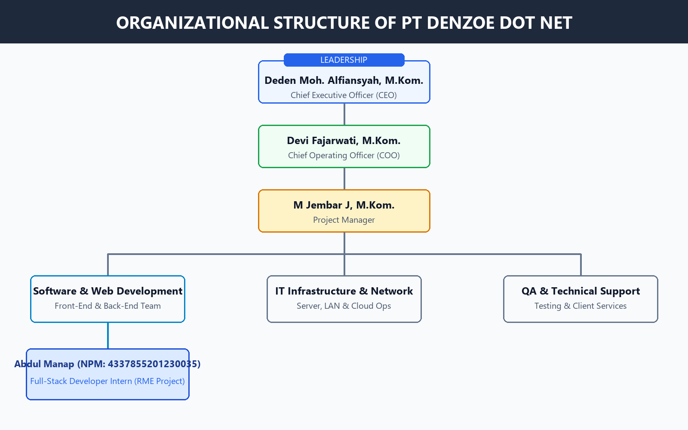

*Figure 2.1: Organization Chart of PT Denzoe Dot Net*

<br>
<div style="page-break-after: always;"></div>

---

## CHAPTER III. INTERNSHIP ACTIVITIES

### 3.1 Job Description

During the 4-month internship period at PT Denzoe Dot Net from September to December 2026 (07 September – 08 December 2026), the author served as a **Full-Stack Web Developer and IT Systems Specialist** assigned to the engineering of the **Clinic Information System and Electronic Medical Record (EMR / RME)** for Klinik Telagasari 24 Jam.

The primary responsibilities and operational duties performed by the author encompassed:
1. System Requirements Elicitation: Conducting technical analysis of clinical and administrative workflows, interviewing healthcare practitioners, reviewing manual physical forms, and formulating formal software requirements specifications in accordance with Permenkes No. 24 of 2022.
2. Relational Database Modeling and Implementation: Engineering a normalized relational schema in MySQL consisting of 208 tables, enforcing strict primary and foreign key constraints, creating indexes on high-frequency search attributes (NIK, No. RM, BPJS card numbers), and developing database migration scripts and seeders.
3. Backend Logic and RESTful Architectural Development: Constructing robust controllers, Eloquent ORM models, policy authorization classes, and service layers within the Laravel 11 framework utilizing PHP 8.2. Implementing strict Role-Based Access Control (RBAC) across 9 user roles.
4. Responsive Frontend Interface Engineering: Developing intuitive, accessible, and responsive user interfaces utilizing Laravel Blade templates, Bootstrap 5.3, custom CSS design systems, FontAwesome icons, SweetAlert2 notifications, and jQuery DOM manipulation.
5. Asynchronous Interactivity and Hardware Printing Integration: Implementing AJAX scripts for instant patient lookups, live counter display refreshes, and structuring CSS print rules (`@page { size: 80mm auto; margin: 0; }`) to interface directly with thermal POS ticket printers.
6. Healthcare Interoperability Bridging: Structuring JSON data payloads and REST API endpoints to facilitate clinical data exchange with the Kemenkes SATUSEHAT FHIR platform and BPJS Kesehatan Antrol queue systems.
7. Verification, Testing, and Deployment: Conducting rigorous Black Box Testing across clinical units, debugging transaction calculation errors, and deploying the application onto the local staging server environment.

The hardware and software development environment utilized throughout this project is specified in Table 3.1.

**Table 3.1 Development Environment Specifications**

| Component Category | Hardware / Software Item | Technical Specification / Version |
| :--- | :--- | :--- |
| Workstation Hardware | Central Processing Unit (CPU) | Intel Core i5 / AMD Ryzen 5 Multi-Core (2.8 GHz+) |
| Workstation Hardware | System Memory (RAM) | 16 GB DDR4 Dual-Channel |
| Workstation Hardware | Storage Drive | 512 GB Solid State Drive (NVMe M.2 SSD) |
| Peripheral Hardware | POS Receipt Printer | Epson TM-T82 / Xprinter 80mm ESC-POS Thermal Printer |
| Operating System | Host Operating System | Microsoft Windows 11 Professional (64-bit) |
| Local Server Suite | Staging Server Environment | Laragon Local Server Environment (Apache 2.4.54) |
| Backend Runtime | Programming Language | PHP Version 8.2.12 (PDO, OpenSSL, cURL enabled) |
| Web Framework | Application Framework | Laravel 11.x (Model-View-Controller Architecture) |
| Database Engine | Relational DBMS | MySQL Server 8.0 / MariaDB 10.4.x |
| Frontend Stack | Styling & Scripting | HTML5, CSS3, Bootstrap 5.3, JavaScript ES6, jQuery 3.7 |
| Development Tools | IDE & Utilities | Visual Studio Code, Git, Postman API Client, Chrome DevTools |

### 3.2 Project Result

The primary outcome of the internship program is the completion of a fully functional, integrated, web-based **Clinic Information System and Electronic Medical Record (EMR / RME)**. The system is engineered to handle high-concurrency clinical workflows across nine distinct user roles, delivering paperless efficiency, automated accounting, and regulatory compliance.

#### 3.2.1 System Requirements Analysis

The operational parameters of the system were formulated through functional and non-functional requirements matrices as detailed in Tables 3.2 and 3.3.

**Table 3.2 Functional Requirements (FR) Matrix**

| Req ID | System Module | Functional Description | System Input | Processing Logic | Expected Deliverable / Output | Priority |
| :--- | :--- | :--- | :--- | :--- | :--- | :--- |
| FR-01 | Authentication | Role-based user authentication & access enforcement | Username, Password | Bcrypt hash check, RBAC session guard | Authenticated session token, Role Dashboard | High |
| FR-02 | Queueing | Self-service kiosk queue generation | Destination poliklinik tap | Sequence increment, ticket layout formatting | 80mm thermal queue ticket with barcode | High |
| FR-03 | Queueing | Audiovisual counter queue calling | Officer calling trigger click | Audio synthesizer generation, display refresh | Synthesized voice calling, TV screen update | High |
| FR-04 | Registration | Patient admission & demographic validation | NIK, Name, Address, BPJS No | Duplicate NIK check, auto No. RM generation | Stored patient record, admission encounter | High |
| FR-05 | Triage | Emergency triage priority classification | Vital signs, GCS, airway status | Priority classification algorithm (ATS/ESI) | Visual triage badge (Red/Yellow/Green) | Medium |
| FR-06 | Doctor EMR | Clinical SOAP record & diagnostic coding | Anamnesis, TTV, ICD-10, ICD-9 | Medical record indexing, encounter finalization | Stored digital RME, updated clinical history | High |
| FR-07 | Diagnostic | Electronic work orders for Lab & Radiology | Clinical test selection | Diagnostic request dispatching to unit queues | Electronic worklist in Lab/Radiology units | Medium |
| FR-08 | Laboratory | Specimen test result entry & validation | Quantitative findings | Reference range validation (Normal/Abnormal) | Printable official laboratory result sheet | Medium |
| FR-09 | Radiology | Imaging documentation & clinical expertise | Exposure logs, radiologist notes | Image storage linkage, encounter status update | Validated diagnostic radiology expertise | Medium |
| FR-10 | Pharmacy | E-prescription dispensing & FEFO tracking | Doctor e-prescription, batch | Automatic stock deduction, fee calculation | Validated dispensing, updated stock ledger | High |
| FR-11 | Pharmacy | Medication thermal label (etiket) printing | Prescribed dose & frequency | Label layout formatting (size: 80mm auto) | Printed thermal medicine dosage label | High |
| FR-12 | Cashier | Multi-service billing ledger aggregation | Patient encounter number | Real-time cost summation across all units | Consolidated itemized patient ledger | High |
| FR-13 | Cashier | Multi-channel payment execution | Cash amount, QRIS, BPJS | Balance calculation, change computation | 80mm thermal receipt, A4 PDF invoice | High |
| FR-14 | Bridging | Kemenkes SATUSEHAT & BPJS bridging | Encounter ID, Diagnoses | REST API JSON payload transformation | API transmission log, SATUSEHAT ID | Medium |
| FR-15 | Analytics | Managerial statistics & revenue reporting | Selected date range | Aggregate SQL querying, chart rendering | Daily/monthly reports, top 10 disease chart | High |

**Table 3.3 Non-Functional Requirements (NFR) Matrix**

| Metric ID | Parameter | Metric Target / Standard | Implementation Mechanism |
| :--- | :--- | :--- | :--- |
| NFR-01 | Performance | Page load time under 1.5 seconds; DB queries under 500 ms | B-Tree indexing on foreign keys, Eloquent eager loading |
| NFR-02 | Security | Cryptographic storage of sensitive passwords | Bcrypt hashing algorithm (cost 12), CSRF form token guards |
| NFR-03 | Authorization | Strict Role-Based Access Control (RBAC) across 9 roles | Laravel middleware authorization (`CheckRole.php`) |
| NFR-04 | Data Integrity | Zero transaction discrepancy during concurrent billing | ACID-compliant database transactions (`DB::transaction`) |
| NFR-05 | Usability | Fully responsive layout across desktop, kiosk, and tablet | Bootstrap 5 grid system, standardized CSS design palette |
| NFR-06 | Compatibility | Formatted ESC-POS printing on standard 80mm printers | Custom CSS `@page { size: 80mm auto; margin: 0; }` styling |

#### 3.2.2 System Modeling and Clinical Workflow Design

The operational architecture of the Clinic Information System follows a continuous, patient-centered clinical pathway illustrated in the General System Flowchart (Figure 3.1).

The step-by-step procedural workflow proceeds as follows:
1. Patient Arrival and Queueing: The patient arrives at the clinic lobby and selects a service unit on the touch-screen kiosk. The system increments the daily queue sequence, formats the layout, and prints an 80mm thermal queue ticket bearing the category code and ticket number.
2. Admissions and Registration: The front-office officer calls the queue ticket via the audiovisual calling system. The officer validates patient demographic identity using their NIK or BPJS card, registers new patients or verifies existing medical records, and assigns the patient to the designated doctor's poliklinik queue.
3. Emergency Triage (If Applicable): Patients presenting acute conditions are routed to the Emergency Unit (IGD), where triage nurses perform initial vital sign evaluations and assign a standardized emergency triage color code (Red, Yellow, or Green).
4. Clinical Consultation (Doctor EMR): The attending doctor reviews the patient's longitudinal medical history, performs physical examinations, records vital signs, and enters primary and secondary diagnoses mapped to the official ICD-10 database.
5. Diagnostic Support (Optional): When specialized diagnostic confirmation is necessary, the doctor issues electronic work orders for laboratory tests or radiological imaging. Analysts enter parameter results against standardized biological reference ranges.
6. Pharmaceutical Fulfillment: The doctor submits an electronic prescription. The pharmacist receives the order, verifies active inventory batches sorted by FEFO rules, calculates compounding fees for concoctions (*racikan*), decrements warehouse stock, prints thermal dosage labels (*etiket*), and dispenses the medication.
7. Cashier Billing and Settlement: The cashier accesses the patient's billing ledger, which automatically consolidates registration charges, medical consultation fees, procedure costs, diagnostic tests, and pharmacy totals into an itemized balance. The cashier records payment via Cash, QRIS, Bank Transfer, or BPJS, and issues an official printed thermal receipt.
8. National Interoperability and Managerial Analytics: The system formats clinical encounter payloads and transmits FHIR resources to the Kemenkes SATUSEHAT platform, synchronizes queue timestamps with BPJS Antrol, and updates managerial business intelligence dashboards in real time.

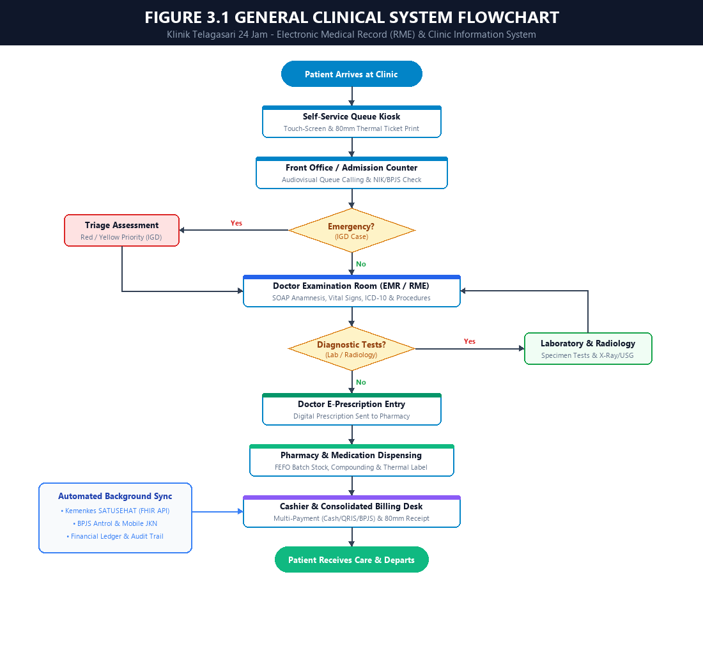

*Figure 3.1: General Clinical System Flowchart*

The system interacts with nine distinct operational actors through defined functional permissions depicted in the System Use Case Diagram (Figure 3.2).

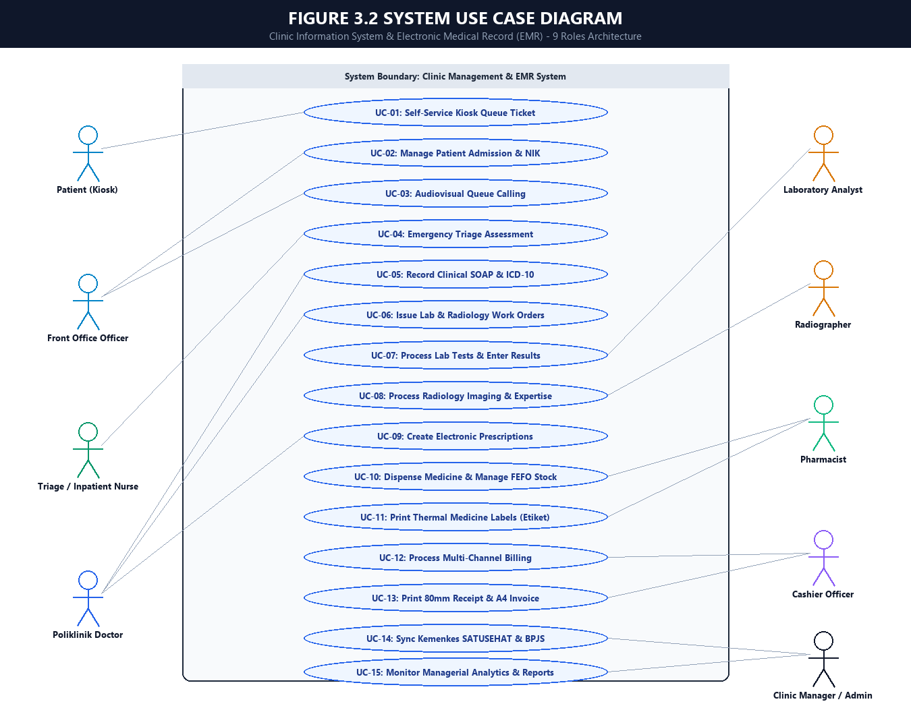

*Figure 3.2: System Use Case Diagram*

The functional roles and operational privileges of each system actor are defined as follows:
1. Front Office Officer: Operates admissions counters, registers demographic profiles, verifies BPJS insurance eligibility, and controls queue calling terminals.
2. Doctor: Reviews longitudinal patient histories, records clinical SOAP examinations, assigns ICD-10/ICD-9 codes, issues diagnostic orders, and writes e-prescriptions.
3. Triage & Inpatient Nurse: Evaluates emergency triage indicators, records baseline vital signs, and maintains nursing care documentation.
4. Laboratory Analyst: Processes specimen testing work orders, inputs qualitative and quantitative parameters, and issues clinical laboratory result certificates.
5. Radiographer: Executes diagnostic imaging orders, logs exposure parameters, and uploads radiological imaging expertise narratives.
6. Pharmacist / Pharmacy Assistant: Validates electronic prescriptions, tracks FEFO batch expirations, calculates compounding charges, decrements stock, and prints thermal dosage labels.
7. Cashier: Reconciles consolidated billing ledgers, manages multi-channel financial settlements, calculates change balances, and generates official payment receipts.
8. Clinic Manager: Monitors real-time clinical KPIs, tracks daily and monthly patient visit volumes, reviews epidemiological disease distributions, and evaluates revenue reports.
9. System Administrator: Oversees user credentials, configures RBAC privilege matrices, maintains master clinic parameters, and manages national bridging API credentials.

The operational flow of control for primary clinical modules is further modeled using UML Activity Diagrams:
1. Figure 3.3 illustrates the Doctor Examination and E-Prescription Workflow, detailing the sequential interaction between the doctor terminal, ICD-10 search engines, and the pharmacy dispensing queue.
2. Figure 3.4 illustrates the Cashier Billing and Multi-Payment Workflow, modeling the consolidation of charges from clinical departments and multi-channel payment reconciliation.

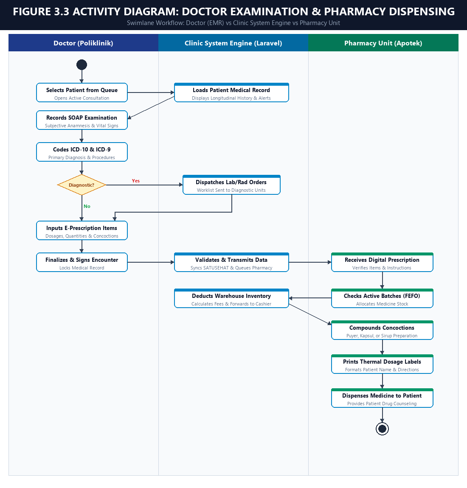

*Figure 3.3: Activity Diagram: Doctor Examination and E-Prescription Workflow*

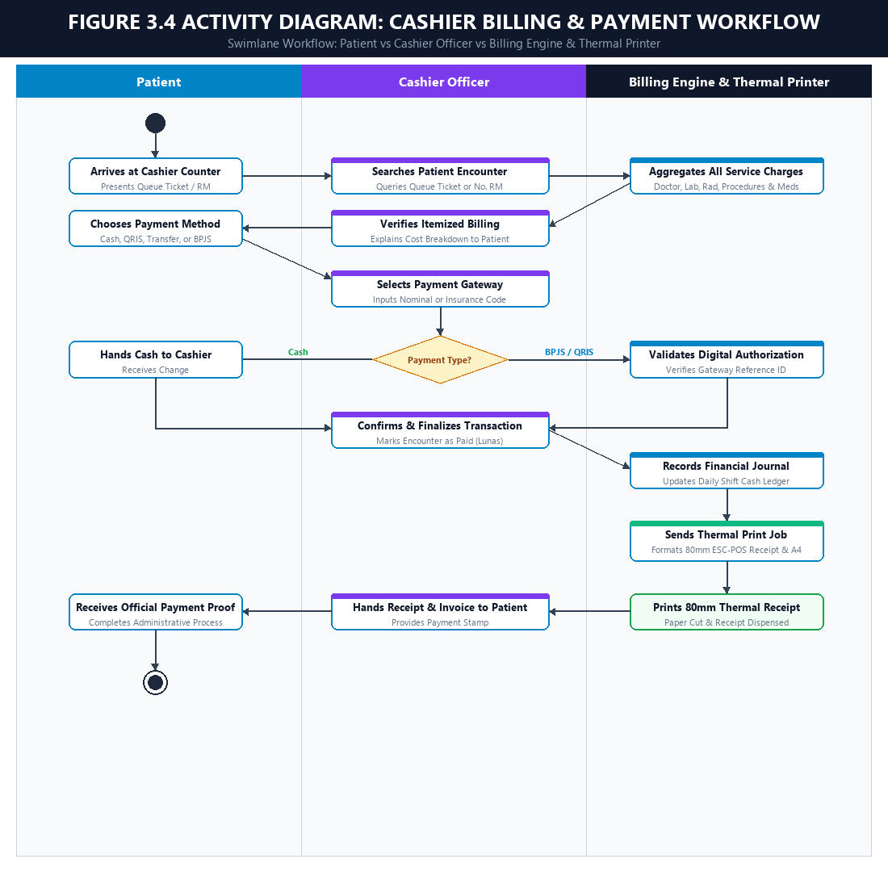

*Figure 3.4: Activity Diagram: Cashier Billing and Payment Workflow*

#### 3.2.3 Relational Database Architecture

The application is backed by an enterprise-grade relational database architecture comprising 208 normalized tables. The relational structure is designed to guarantee referential integrity, eliminate duplicate records, optimize query performance through B-tree indexing on foreign keys, and maintain comprehensive audit trails for medical and financial transactions.

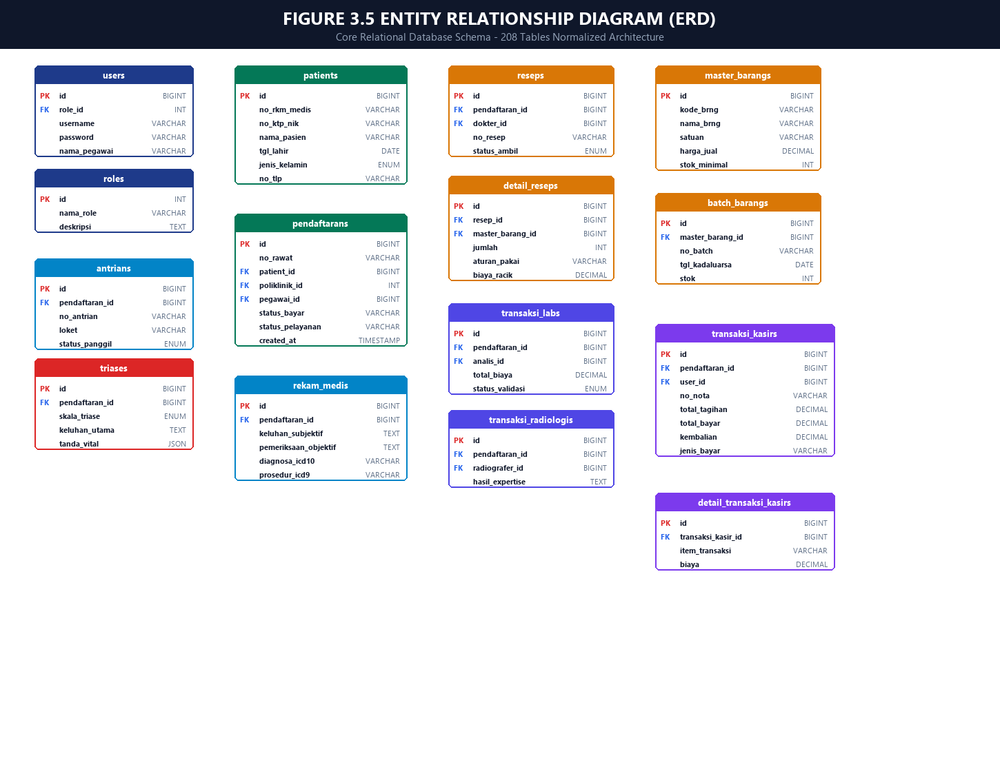

*Figure 3.5: Entity Relationship Diagram (ERD)*

The schema definition and functional responsibility of the core relational tables are summarized in Table 3.4.

**Table 3.4 Core Database Schema and Data Dictionary**

| Table Identifier | Primary Key | Foreign Key References | Functional Purpose & Architectural Scope |
| :--- | :--- | :--- | :--- |
| `users` | `id` | `role_id` | Stores user credentials (Bcrypt hashed), personal identities, and RBAC privileges. |
| `patients` | `id` | - | Master demographic record, storing No. RM, NIK, full name, birth date, gender, address. |
| `pendaftarans` | `id` | `patient_id`, `poliklinik_id`, `pegawai_id` | Tracks clinical visit encounters, doctor assignments, and admission timestamps. |
| `antrians` | `id` | `pendaftaran_id`, `poliklinik_id` | Manages kiosk queue sequences, counter routing, calling states, and MJKN logs. |
| `triases` | `id` | `pendaftaran_id` | Stores emergency triage evaluations, GCS metrics, and emergency priority colors. |
| `rekam_medis` | `id` | `pendaftaran_id`, `patient_id` | Stores clinical SOAP consultation notes, vital signs, ICD-10, and ICD-9 codes. |
| `transaksi_labs` | `id` | `pendaftaran_id`, `analis_id` | Tracks laboratory diagnostic orders, specimen test results, and biological ranges. |
| `transaksi_radiologis` | `id` | `pendaftaran_id`, `radiografer_id` | Records radiology exam orders, technical exposure logs, and imaging narratives. |
| `reseps` | `id` | `pendaftaran_id`, `pegawai_id` | Header table for electronic prescriptions, dosage rules, compounding data, and status. |
| `detail_reseps` | `id` | `resep_id`, `master_barang_id` | Itemized prescribed medicines, dispensed quantities, unit prices, and compounding fees. |
| `master_barangs` | `id` | `satuan_id`, `kategori_id` | Master catalog of pharmaceutical items, sales pricing, purchase costs, and reorder levels. |
| `batch_barangs` | `id` | `master_barang_id`, `gudang_id` | Manages stock batches, received quantities, and FEFO expiration dates. |
| `transaksi_kasirs` | `id` | `pendaftaran_id`, `user_id` | Central billing ledger, calculating aggregate fees, discounts, and payment channels. |
| `detail_transaksi_kasirs`| `id` | `transaksi_kasir_id` | Itemized charges originating from admissions, consultations, procedures, lab, and pharmacy. |
| `bridging_configs` | `id` | - | Archives OAuth2 credentials and endpoints for Kemenkes SATUSEHAT and BPJS APIs. |

#### 3.2.4 User Interface Implementation

The system user interface was developed to provide an intuitive, responsive, and ergonomic workflow for healthcare staff and patients.

1. User Authentication and Role-Based Login Interface:
The login gateway enforces strict authentication security. Users authenticate using their assigned credentials accompanied by mathematical captcha verification to prevent automated brute-force attacks. The system verifies the user's encrypted Bcrypt hash, checks their active status, inspects their assigned role, and routes the authenticated session to their corresponding operational dashboard.
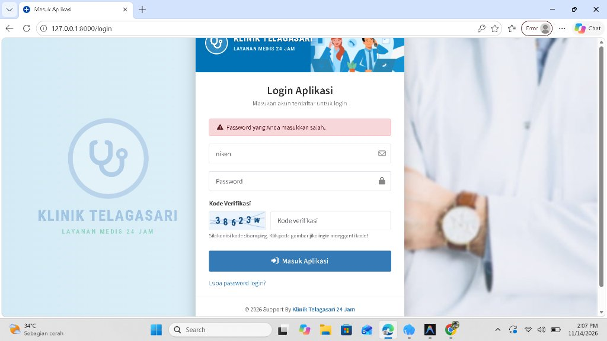

*Figure 3.6: User Authentication and Role-Based Login Interface*

2. Self-Service Queue Kiosk and Thermal Ticket Dispenser:
The kiosk interface allows arriving patients to obtain a queue ticket with a single touch on a 15.6-inch terminal. The system generates sequential ticket numbers, category identifiers (e.g., A058 for Doctor Poliklinik), and triggers an automatic print routine delivering an 80mm thermal receipt complete with clinic branding and queue instructions.
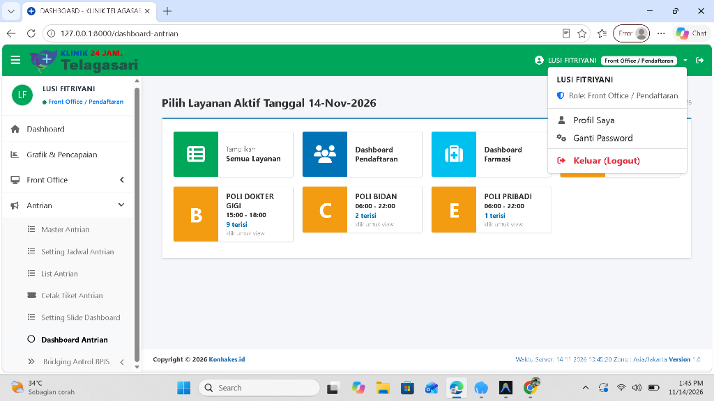

*Figure 3.7: Self-Service Queue Kiosk and Thermal Ticket Interface*

3. Front Office Patient Registration and Master Data Interface:
The patient management module allows admissions staff to perform instant record lookups via asynchronous AJAX autocomplete using NIK, No. RM, or patient names. For new patient admissions, the interface enforces data validation, verifies BPJS membership, automatically generates unique medical record numbers, and records emergency contacts and General Consent agreements.
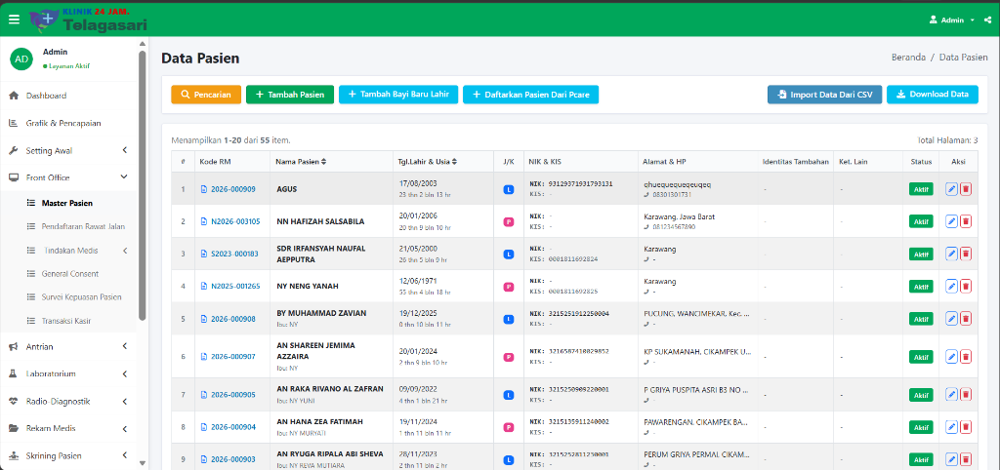

*Figure 3.8: Front Office Patient Registration and Master Data Interface*

4. Doctor Electronic Medical Record (EMR/SOAP) Interface:
The clinical consultation interface serves as the primary workspace for attending doctors. It displays longitudinal patient medical history, drug allergy alerts, and active visit encounters. Doctors enter examination data organized into Subjective anamnesis, Objective vital signs, Assessment diagnoses linked to the official ICD-10 database, and Plan procedures coded in ICD-9-CM, alongside electronic diagnostic orders for laboratory or radiology tests.
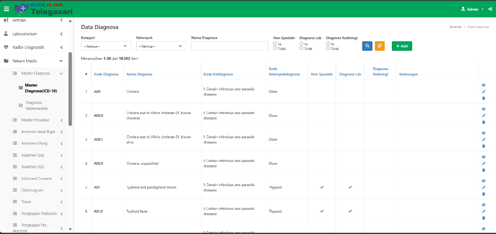

*Figure 3.9: Doctor Electronic Medical Record (EMR/SOAP) Interface*

5. Pharmacy Medication Dispensing and Inventory Interface:
The pharmacy interface receives electronic prescriptions dispatched from the doctor's consultation in real-time. Pharmacists can review medicine names, prescribed quantities, and dosage frequencies. The system automatically suggests active batches sorted by First Expired, First Out (FEFO), computes compounding fees for concoctions (*racikan*), decrements warehouse stock upon dispensing, and generates printable thermal dosage labels (*etiket obat*).

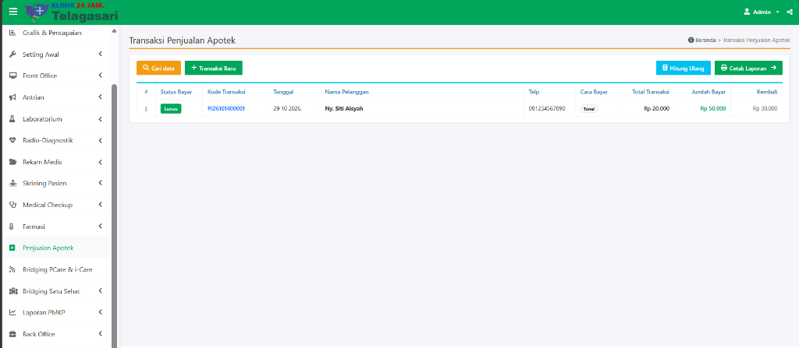

*Figure 3.10: Pharmacy Medication Dispensing and Inventory Interface*

6. Cashier Unified Billing and Multi-Payment Interface:
The cashier interface aggregates all clinical service costs incurred during a patient's visit into an itemized financial statement. It calculates the consolidated total from registration fees, doctor consultations, nursing procedures, laboratory tests, radiology imaging, and medications. The cashier selects the payment method (Cash, QRIS, Bank Transfer, or BPJS Insurance), computes change amounts, and prints official 80mm thermal receipts and A4 invoices.

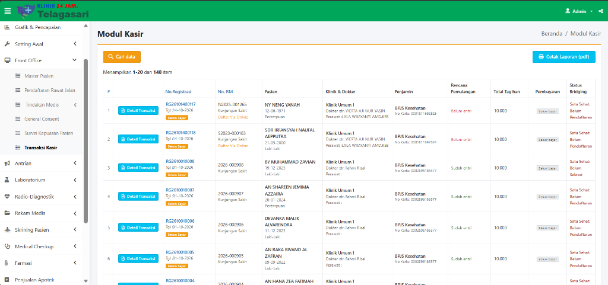

*Figure 3.11: Cashier Unified Billing and Multi-Payment Interface*

7. Executive Dashboard and Managerial Analytics Interface:
The managerial dashboard provides clinic leadership with real-time operational metrics. It renders interactive visual charts illustrating daily and monthly patient visit volumes, gender distributions, the Top 10 Most Frequent Diseases (ICD-10 epidemiology), and financial revenue summaries broken down by payment channels and clinic departments.

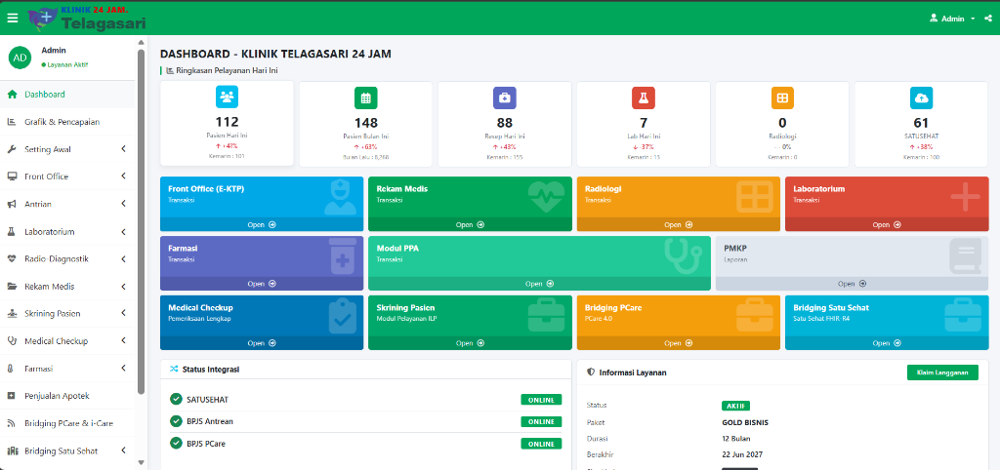

*Figure 3.12: Executive Dashboard and Managerial Analytics Interface*

#### 3.2.5 Core Source Code Architecture

The backend application is structured according to the Model-View-Controller (MVC) architectural pattern within Laravel 11. Core functionalities are implemented across specialized controllers, service layers, and authorization middleware:

1. Routing and Endpoint Architecture (`routes/web.php`):  
   Defines over 1,200 application routes organized into authenticated role-specific groups protected by session security, CSRF token validation, and rate limiters.
2. Role-Based Access Control Middleware (`app/Http/Middleware/CheckRole.php`):  
   Intercepts every incoming HTTP request, examines the authenticated user's role against route permissions, and prevents unauthorized horizontal or vertical privilege escalation.
3. Queue Kiosk Controller (`app/Http/Controllers/AntrianController.php`):  
   Manages automated queue ticketing, sequence resets, and formats CSS print instructions (`@page { size: 80mm auto; margin: 0; }`) for thermal receipt dispensers.
4. Clinical Examination Controller (`app/Http/Controllers/PemeriksaanController.php`):  
   Executes atomic database transactions (`DB::transaction`) to record clinical SOAP assessments, map ICD-10 diagnostic codes, generate electronic prescriptions, and format JSON payloads for Kemenkes SATUSEHAT synchronization.
5. Pharmacy Dispensing Controller (`app/Http/Controllers/FarmasiController.php`):  
   Enforces First Expired, First Out (FEFO) inventory algorithms, deducts batch stock quantities, calculates compounding fees, and formats thermal medicine labels.
6. Cashier Billing Controller (`app/Http/Controllers/TransaksiKasirController.php`):  
   Consolidates itemized charges across medical, diagnostic, and pharmacy tables, validates received payments, updates ledger statuses to "Paid", and logs financial entries into the cash journal.

#### 3.2.6 System Verification and Black Box Testing

To ensure complete functional reliability and zero-defect execution, the developed modules underwent comprehensive Black Box Testing. Testing scenarios evaluated input validation, database transactions, calculation accuracy, and security access controls across operational roles as detailed in Table 3.5.

**Table 3.5 Black Box Functional Testing Results Matrix**

| Test Case ID | Tested Module | Test Scenario & Input Data | Expected System Behavior | Actual Test Result | Test Status |
| :--- | :--- | :--- | :--- | :--- | :--- |
| TC-01 | Authentication | Input valid username, password, and correct mathematical captcha | System authenticates credentials, establishes session, redirects to role dashboard | Login successful; redirected to appropriate dashboard | **PASSED** |
| TC-02 | Authentication | Input invalid password or incorrect captcha answer | System rejects login attempt, displays error message, retains username input | Access blocked; clear error alerts displayed | **PASSED** |
| TC-03 | Authorization | Non-authorized user attempts direct URL access to Cashier / Admin route | Middleware intercepts request and returns HTTP 403 Forbidden unauthorized alert | Access blocked; redirected to home with error banner | **PASSED** |
| TC-04 | Kiosk Queue | Arriving patient taps "Poli Umum" service button on Kiosk terminal | System increments daily counter, saves queue record, triggers thermal printer | Ticket generated with category code (e.g. A058) | **PASSED** |
| TC-05 | Registration | Input new patient NIK already existing in relational database | System detects duplicate NIK, aborts insertion, displays existing patient profile | Duplicate prevented; existing patient loaded | **PASSED** |
| TC-06 | Registration | Asynchronous search by typing 3 letters of patient name in AJAX modal | System queries database asynchronously and returns matching patient list | Live patient list displayed without page reload | **PASSED** |
| TC-07 | Doctor EMR | Doctor enters SOAP notes, selects ICD-10 code, and clicks "Simpan" | System commits transaction, updates visit status to "Selesai", saves RME | Medical record archived; encounter closed | **PASSED** |
| TC-08 | Diagnostic | Doctor submits electronic laboratory work order with selected parameters | Work order is dispatched and instantly displayed on active laboratory queue | Order appeared on lab analyst dashboard | **PASSED** |
| TC-09 | Pharmacy | Pharmacist confirms dispensing for e-prescription items with batch selection | Stock quantity is deducted from warehouse ledger according to FEFO batch | Stock decremented accurately; usage logged | **PASSED** |
| TC-10 | Pharmacy | Pharmacist clicks "Cetak Etiket" for dispensed oral antibiotic prescription | System renders formatted label preview and prints thermal medication label | Etiket printed with patient name, dose, and instructions | **PASSED** |
| TC-11 | Cashier | Cashier enters patient encounter number to generate billing statement | System aggregates fees across registration, doctor, lab, and pharmacy items | Itemized statement matches exact subtotal sum | **PASSED** |
| TC-12 | Cashier | Cashier inputs nominal payment lower than total invoice amount | System rejects payment submission and displays an underpayment validation error | Transaction blocked; underpayment warning displayed | **PASSED** |
| TC-13 | Cashier | Cashier selects "Tunai", enters sufficient amount, and clicks "Bayar" | System computes change, updates status to "Lunas", and prints thermal receipt | Invoice marked paid; official thermal receipt printed | **PASSED** |
| TC-14 | Interoperability| System triggers bridging sync for finalized clinical encounter | System transforms encounter into FHIR JSON payload and records API log | FHIR resource accepted; SATUSEHAT encounter linked | **PASSED** |
| TC-15 | Analytics | Manager selects monthly date range on Executive Dashboard | Charts re-render showing visit trends, Top 10 ICD-10, and revenue sums | Charts dynamically rendered with correct metrics | **PASSED** |

<br>
<div style="page-break-after: always;"></div>

---

## CHAPTER IV. PERSONAL RESULT / EVALUATION / POINTS LEARNED

### 4.1 Personal Result

During the 4-month internship program at PT Denzoe Dot Net (07 September 2026 – 08 December 2026), the author achieved significant individual outcomes and tangible professional competencies. Serving as a Full-Stack Web Developer and IT Systems Specialist on the Clinic Information System and Electronic Medical Record (EMR) project for Klinik Telagasari 24 Jam, the author successfully delivered the following contributions:

1. End-to-End Application Delivery: Successfully participated in the full software engineering lifecycle from requirements analysis, database schema modeling, backend coding in Laravel 11, frontend design in Bootstrap 5, to functional system verification.
2. Relational Database Engineering: Actively contributed to the design, optimization, and migration of 208 relational tables in MySQL, ensuring strict normalization (3NF), foreign key referential integrity, and efficient indexing for high-frequency queries.
3. Hardware Integration Proficiency: Developed custom ESC-POS printing integration via Web Print APIs and structured CSS page rules (`@page { size: 80mm auto; margin: 0; }`), enabling seamless automated 80mm thermal receipt and queue ticket generation.
4. Healthcare Domain Specialization: Acquired deep functional domain knowledge regarding healthcare operations, including clinical SOAP workflows, emergency triage protocols, WHO ICD-10 and ICD-9-CM coding standards, pharmaceutical FEFO inventory management, and national interoperability guidelines (Permenkes No. 24 of 2022).
5. Defect-Free System Verification: Executed 15 comprehensive Black Box Testing scenarios covering all primary clinical and administrative modules, achieving a 100% pass rate without critical architectural defects or calculation discrepancies.

### 4.2 Evaluation

The internship experience at PT Denzoe Dot Net provided a realistic setting for rigorous personal and academic evaluation, contrasting university lecture theories against the complex demands of industrial software engineering.

#### 4.2.1 Academic Theory vs Real-World Implementation

Throughout the internship, the author observed both strong convergence and notable divergences between academic theories taught at Horizon University Indonesia and their practical application in enterprise software development:

1. Software Engineering Principles: Theoretical models such as the Model-View-Controller (MVC) architectural pattern, Object-Oriented Programming (OOP), and separation of concerns proved exceptionally vital in enterprise codebases. Structuring controllers, models, and middleware cleanly allowed multiple developers to collaborate without conflicting logic.
2. Database Normalization vs Query Performance: While academic courses emphasize strict normalization up to 3NF/BCNF to eliminate redundancy, practical enterprise systems occasionally require deliberate, calculated denormalization and B-tree index optimizations on composite foreign keys to sustain sub-second query execution times during concurrent lookups.
3. User Interface and Human-Computer Interaction (HCI): Academic projects frequently emphasize visual aesthetics, whereas enterprise healthcare environments demand extreme ergonomic efficiency, high contrast, minimal clicks, keyboard accessibility, and zero-reload asynchronous AJAX operations to minimize patient waiting times at admissions counters.

#### 4.2.2 Technical Skills and Competencies Acquired

The practical assignments completed during the internship enriched the author's technical capabilities across modern engineering domains:

1. Advanced Framework Proficiencies: Mastered the Laravel 11 ecosystem, including Eloquent ORM relationships (`belongsTo`, `hasMany`, `whereHas`), database migrations, seeders, custom middleware authorization guards, and service container bindings.
2. Asynchronous Web Technologies: Developed expertise in JavaScript ES6, jQuery, and Fetch API to construct responsive Single-Page Application (SPA)-like interfaces that dynamically manipulate the DOM without requiring full-page reloads.
3. National Healthcare Interoperability: Gained practical understanding of RESTful API bridging, OAuth2 token authentication, and JSON schema formatting conforming to the HL7 FHIR (Fast Healthcare Interoperability Resources) standard utilized by Kemenkes SATUSEHAT and BPJS Kesehatan.
4. Industrial Version Control Workflows: Gained proficiency in professional Git version control practices, including branch management, pull request reviews, commit structuring, and collaborative code merging.

#### 4.2.3 Identification of Strengths and Areas for Improvement

Through daily engagement in software development tasks, the author identified core personal strengths and areas requiring continuous improvement:

1. Personal Strengths:  
   a. Strong analytical ability in dissecting complex business requirements into modular database schemas and clean controller logic.  
   b. Persistence and systematic problem-solving aptitude when diagnosing and resolving complex runtime bugs and transaction anomalies.  
   c. Effective cross-functional communication, actively translating feedback from medical practitioners into user-friendly interface designs.  
2. Areas for Improvement:  
   a. Time Estimation and Scope Management: In the initial phases, the author tended to spend excessive time striving for theoretical code perfection; through mentorship, the author learned to balance code elegance against delivery timelines.  
   b. Stress Management Under Tight Deadlines: Developing composure when managing concurrent revision requests from multiple clinical departments during active sprint milestones.

#### 4.2.4 Personal Growth and Future Career Impact

The internship at PT Denzoe Dot Net served as a transformative milestone in the author's personal and professional maturity. The author developed professional discipline, workplace punctuality, accountability for production code, and an appreciation for the social impact of healthcare technology in serving patients.

This immersive experience has definitively solidified the author's career ambition. Upon completing the undergraduate degree in Informatics at Horizon University Indonesia, the author intends to pursue a professional career as a **Full-Stack Software Engineer** or **Healthcare Information Systems Specialist**, equipped with a verified industrial portfolio, practical engineering capabilities, and enterprise-grade software development experience.

<br>
<div style="page-break-after: always;"></div>

---

## CHAPTER V. RECOMMENDATION

Based on the direct technical observations and operational experiences gained throughout the 4-month internship program at PT Denzoe Dot Net and Klinik Telagasari 24 Jam (07 September 2026 – 08 December 2026), the author offers constructive recommendations for organizational enhancement.

### 5.1 Recommendation for Company and Clinical Partner

1. Automated Cloud Backup and Disaster Recovery Infrastructure:  
   It is strongly recommended that PT Denzoe Dot Net assist the clinical partner in implementing automated, encrypted off-site cloud backups (such as Google Cloud Storage or Amazon S3) executed via nightly cron jobs. This safeguard ensures that critical clinical medical records and financial journals remain resilient against local hardware failure or catastrophic on-premise events.
2. Local Area Network (LAN) Infrastructure Optimization:  
   Given that Klinik Telagasari 24 Jam operates continuously 24 hours daily with simultaneous data transmission across admissions, consultation rooms, the pharmacy, and cashier counters, the clinic management should upgrade to managed gigabit switches and deploy redundant Internet Service Providers (ISPs) to prevent latency spikes during real-time SATUSEHAT and BPJS bridging transactions.
3. Periodic Refresher Training for Clinical Staff:  
   To maintain data consistency and minimize administrative entry errors, the clinic should establish structured, quarterly refresher workshops for medical and administrative staff focusing on standardized ICD-10 diagnostic entry and digital prescription workflows.

### 5.2 Recommendation for Horizon University Indonesia

1. Project-Based Curriculum Enrichment:  
   The Faculty of Information and Computer Technology (FICT) should incorporate real-world, multi-tiered enterprise project scenarios—such as healthcare systems, logistics management, and financial accounting—into advanced courses like Web Programming and Software Engineering, better preparing students for industrial expectations.
2. Dedicated Technical Workshops on National Interoperability Standards:  
   The Informatics Study Program is encouraged to organize specialized guest lectures and laboratory workshops exploring national API bridging architectures, such as the Kemenkes SATUSEHAT FHIR HL7 standard and open banking APIs, equipping graduates with high-demand integration proficiencies.
3. Streamlined Digital Internship Mentorship Portal:  
   The university should enhance its internal internship tracking platform to facilitate streamlined weekly reporting, automated milestone approvals, and asynchronous mentor feedback, ensuring seamless communication between university faculty mentors and company supervisors.

<br>
<div style="page-break-after: always;"></div>

---

## APPENDICES

### APPENDIX 1: CURRICULUM VITAE

```text
CURRICULUM VITAE
ABDUL MANAP
Informatics Undergraduate Student | Horizon University Indonesia
Contact: (+62) 812-8888-2026 | Email: abdulmanap@example.com | Karawang, West Java, Indonesia

SUMMARY
A dedicated, detail-oriented Informatics student at Horizon University Indonesia with a strong academic foundation in software engineering, full-stack web development, and relational database systems. Experienced in developing enterprise-grade healthcare management applications using Laravel, PHP 8.2, MySQL, JavaScript, and Bootstrap through a comprehensive 4-month internship at PT Denzoe Dot Net.

EDUCATION
Horizon University Indonesia — Karawang, West Java
Bachelor of Computer Science in Informatics (S1) | 2023 – Present
• Current Semester: Semester 7
• Current GPA: 3.xx / 4.00
• Relevant Coursework: Software Engineering, Web Programming, Relational Database Systems, Object-Oriented Programming, Data Structures, Human-Computer Interaction.

TECHNICAL SKILLS
• Programming Languages: PHP (8.2+), JavaScript (ES6+), SQL, HTML5, CSS3.
• Frameworks & Libraries: Laravel 11 (MVC), Bootstrap 5.3, jQuery, SweetAlert2.
• Databases & Tools: MySQL, MariaDB, Laragon, Git, Postman, Visual Studio Code.
• Healthcare & Protocols: REST API, JSON, HL7 FHIR (SATUSEHAT), BPJS Antrol, ESC-POS Thermal Printing.

PROFESSIONAL EXPERIENCE
PT Denzoe Dot Net — Karawang, West Java
Full-Stack Web Developer & IT Systems Specialist Intern | Sep 2026 – Dec 2026
• Engineered the Clinic Management Information System and Electronic Medical Record (EMR) for Klinik Telagasari 24 Jam.
• Designed and normalized 208 relational database tables in MySQL.
• Built automated queue ticketing with 80mm thermal receipt printing and audiovisual calling.
• Implemented clinical SOAP records, ICD-10 coding, e-prescriptions, and cashier multi-payment billing.
• Conducted 15 comprehensive Black Box Testing scenarios with a 100% pass rate.
```

<br>

### APPENDIX 3: PROFILE LINKEDIN

```text
PROFILE LINKEDIN
Name: Abdul Manap
Headline: Informatics Student at Horizon University Indonesia | Full-Stack Web Developer | Laravel & MySQL Enthusiast
Location: Karawang Regency, West Java, Indonesia
Public Profile URL: linkedin.com/in/abdul-manap-inf23
Summary:
Passionate undergraduate software engineer with practical immersion in developing enterprise healthcare information systems (SIMRS & EMR). Skilled in Laravel, MySQL, RESTful APIs, and responsive front-end engineering. Proven ability to translate complex clinical and financial workflows into reliable, scalable software solutions.
```

<br>

### APPENDIX 4: INTERNSHIP AGREEMENT FORM

```text
INTERNSHIP AGREEMENT FORM
(SURAT PERJANJIAN PROGRAM MAGANG MAHASISWA)

The undersigned below:
1. Name of Company Supervisor : Deden Moh. Alfiansyah, M.Kom.
   Position                   : Chief Executive Officer (CEO), PT Denzoe Dot Net
   Company Address            : Perum Cengkong Persada Block E22 No. 12A, Purwasari, Karawang

2. Name of University Mentor   : Dedih, M.Kom.
   Institution                : Horizon University Indonesia
   Position                   : Faculty Internship Mentor, FICT

3. Name of Student            : Abdul Manap
   NPM                        : 4337855201230035
   Study Program              : Informatics (S1)

Hereby mutually agree that the student named above shall participate in the Field Work Internship Program for 4 Months from 07 September 2026 until 08 December 2026 at PT Denzoe Dot Net, complying with all corporate codes of conduct, data confidentiality regulations, and academic guidelines of Horizon University Indonesia.
```

<br>
<div style="page-break-after: always;"></div>

---

### APPENDIX 5: INTERNSHIP MONTHLY REPORT
#### Narrative Weekly and Daily Activity Breakdown (4 Months: 07 September – 08 December 2026)

The following tables document the chronological record of daily and weekly engineering activities performed by Abdul Manap throughout the 4-month internship at PT Denzoe Dot Net and Klinik Telagasari 24 Jam, concluding on Tuesday, 08 December 2026.

#### Month 1: September 2026 (Weeks 1 to 4)

| Week & Date Range | Day & Date | Specific Tasks and Technical Activities Performed | Output & Deliverables | Supervisor Approval |
| :--- | :--- | :--- | :--- | :--- |
| **Week 1**<br>(07 Sep – 11 Sep 2026) | Mon, 07 Sep 2026 | Company onboarding, workplace orientation, introduction to CEO, COO, and Project Manager at PT Denzoe Dot Net office. | Internship workspace & schedule confirmed | Approved |
| | Tue, 08 Sep 2026 | Technical briefing on project scope: Developing web-based Clinic Information System and EMR for Klinik Telagasari 24 Jam. | Project overview document | Approved |
| | Wed, 09 Sep 2026 | Initial field visit to Klinik Telagasari 24 Jam; observation of physical layout, lobby, admissions counters, and consultation rooms. | Clinical field observation notes | Approved |
| | Thu, 10 Sep 2026 | In-depth review of Permenkes No. 24 of 2022 on Electronic Medical Records and national compliance requirements. | Regulatory compliance checklist | Approved |
| | Fri, 11 Sep 2026 | Weekly sprint retrospective with Project Manager; compiling Week 1 summary and setting requirements elicitation targets. | Week 1 Summary Report | Approved |
| **Week 2**<br>(14 Sep – 18 Sep 2026) | Mon, 14 Sep 2026 | Interviewing front-office officers regarding patient admissions, manual registration books, and queue management bottlenecks. | Admissions workflow notes | Approved |
| | Tue, 15 Sep 2026 | Interviewing attending doctors regarding consultation steps, physical examination notes, vital signs, and paper medical folders. | Clinical consultation requirements | Approved |
| | Wed, 16 Sep 2026 | Observing pharmacy dispensing operations, manual prescription handoffs, stock card bookkeeping, and compounding concoctions. | Pharmacy workflow analysis | Approved |
| | Thu, 17 Sep 2026 | Analyzing cashier billing procedures, calculation of medical and pharmacy fees, receipt issuance, and cash reconciliation. | Billing & ledger requirements | Approved |
| | Fri, 18 Sep 2026 | Consolidating findings into formal Software Requirements Specifications (SRS), defining 15 Functional and 6 Non-Functional requirements. | Draft SRS Document | Approved |
| **Week 3**<br>(21 Sep – 25 Sep 2026) | Mon, 21 Sep 2026 | Designing General Clinical System Flowchart illustrating the end-to-end patient journey from kiosk to cashier settlement. | Clinical System Flowchart | Approved |
| | Tue, 22 Sep 2026 | Formulating System Use Case Diagram and defining operational actor permissions across 9 distinct user roles. | Use Case Diagram & Actor Matrix | Approved |
| | Wed, 23 Sep 2026 | Developing detailed Use Case Specifications for Patient Registration, Doctor EMR, Pharmacy Dispensing, and Cashier Billing. | Use Case Specification Tables | Approved |
| | Thu, 24 Sep 2026 | Designing UML Activity Diagrams for Doctor Examination & E-Prescription and Cashier Billing & Multi-Payment workflows. | Activity Diagrams (Doctor & Cashier) | Approved |
| | Fri, 25 Sep 2026 | Modeling relational database structure; conceptualizing normalized entities for patients, encounters, medical records, and pharmacy. | Conceptual Data Model | Approved |
| **Week 4**<br>(28 Sep – 02 Oct 2026) | Mon, 28 Sep 2026 | Establishing local staging server environment on Windows 11 using Laragon (Apache 2.4, PHP 8.2.12, MariaDB 10.4). | Staging environment configured | Approved |
| | Tue, 29 Sep 2026 | Initializing Laravel 11 project structure, configuring version control repository (Git), establishing environment variables (`.env`). | Laravel 11 project initialized | Approved |
| | Wed, 30 Sep 2026 | Developing database migration scripts for core demographic and organizational tables (`users`, `roles`, `patients`, `polikliniks`). | Core Database Migrations | Approved |
| | Thu, 01 Oct 2026 | Engineering database seeders for 9 user roles and standardizing credentials (`password123`) across development test accounts. | Master Seeders Executed | Approved |
| | Fri, 02 Oct 2026 | Implementing user authentication controller and Role-Based Access Control (RBAC) middleware (`CheckRole.php`) with Bcrypt hashing. | Authentication & RBAC functional | Approved |

#### Month 2: October 2026 (Weeks 5 to 8)

| Week & Date Range | Day & Date | Specific Tasks and Technical Activities Performed | Output & Deliverables | Supervisor Approval |
| :--- | :--- | :--- | :--- | :--- |
| **Week 5**<br>(05 Oct – 09 Oct 2026) | Mon, 05 Oct 2026 | Designing responsive UI layout for front-office patient admissions using Bootstrap 5.3 and custom clinic styling. | Registration UI Mockups | Approved |
| | Tue, 06 Oct 2026 | Constructing Patient Registration controller (`PasienController.php`); creating validation rules for NIK, BPJS, and contact info. | Patient Controller Logic | Approved |
| | Wed, 07 Oct 2026 | Implementing algorithm for automatic generation of sequential unique Medical Record Numbers (No. RM) and visit encounter IDs. | Auto-generator algorithm | Approved |
| | Thu, 08 Oct 2026 | Developing asynchronous AJAX autocomplete search for existing patients by NIK, No. RM, or Name without full-page reloads. | Live AJAX search functional | Approved |
| | Fri, 09 Oct 2026 | Sprint review with Project Manager; testing patient registration flow and duplicate NIK detection mechanisms. | Sprint 5 Sign-off | Approved |
| **Week 6**<br>(12 Oct – 16 Oct 2026) | Mon, 12 Oct 2026 | Designing Self-Service Queue Kiosk interface optimized for 15.6-inch touchscreen lobby displays. | Touchscreen Kiosk UI | Approved |
| | Tue, 13 Oct 2026 | Developing `AntrianController.php` to handle queue sequences, category prefixes (A: Doctor, B: BPJS, C: Pharmacy/Cashier). | Queue backend controller | Approved |
| | Wed, 14 Oct 2026 | Implementing ESC-POS thermal ticket formatting utilizing CSS print rules (`@page { size: 80mm auto; margin: 0; }`). | 80mm thermal queue ticket print | Approved |
| | Thu, 15 Oct 2026 | Integrating Web Speech API and audiovisual synthesizer to broadcast ticket calling sounds to clinic lobby TV monitors. | Lobby TV calling display | Approved |
| | Fri, 16 Oct 2026 | Conducting physical testing with Epson TM-T82 thermal printer connected via USB port; verifying cut and print speed. | Physical hardware test passed | Approved |
| **Week 7**<br>(19 Oct – 23 Oct 2026) | Mon, 19 Oct 2026 | Developing Emergency Triage assessment interface; structuring parameters for GCS, airway, breathing, circulation, and vital signs. | Triage assessment module | Approved |
| | Tue, 20 Oct 2026 | Implementing automated triage categorization algorithm to assign color-coded clinical badges (Red, Yellow, Green, Black). | Color-coded triage logic | Approved |
| | Wed, 21 Oct 2026 | Constructing Doctor EMR examination workspace (`PemeriksaanController.php`) adopting standard SOAP clinical structure. | Doctor EMR controller | Approved |
| | Thu, 22 Oct 2026 | Developing interactive forms for Subjective anamnesis, vital signs recording (blood pressure, pulse, temperature, respiration, BMI). | SOAP clinical interface | Approved |
| | Fri, 23 Oct 2026 | Implementing allergy alert badges on patient header to prominently display drug and food allergies upon record retrieval. | Allergy safety banner | Approved |
| **Week 8**<br>(26 Oct – 30 Oct 2026) | Mon, 26 Oct 2026 | Sourcing and importing official WHO ICD-10 database (18,000+ diagnostic codes) into relational `master_icd10` table. | ICD-10 master database | Approved |
| | Tue, 27 Oct 2026 | Developing fast autocomplete search for ICD-10 diagnostic codes supporting simultaneous code (e.g. J06.9) and keyword queries. | Live ICD-10 search tool | Approved |
| | Wed, 28 Oct 2026 | Importing ICD-9-CM procedure coding master data; linking procedural codes and standard medical service tariffs. | ICD-9-CM procedure module | Approved |
| | Thu, 29 Oct 2026 | Integrating electronic prescription (e-prescription) sub-module within doctor examination form, supporting patent and concoctions. | E-prescription interface | Approved |
| | Fri, 30 Oct 2026 | Sprint review: Demonstrating end-to-end clinical examination flow to Project Manager and clinical mentor. | Sprint 8 Milestone Approved | Approved |

#### Month 3: November 2026 (Weeks 9 to 12)

| Week & Date Range | Day & Date | Specific Tasks and Technical Activities Performed | Output & Deliverables | Supervisor Approval |
| :--- | :--- | :--- | :--- | :--- |
| **Week 9**<br>(02 Nov – 06 Nov 2026) | Mon, 02 Nov 2026 | Designing electronic diagnostic order system allowing doctors to issue Laboratory and Radiology requests directly from EMR. | Diagnostic order sub-system | Approved |
| | Tue, 03 Nov 2026 | Developing Laboratory Analyst workspace (`LaboratoriumController.php`); creating parameter result forms and reference range validators. | Lab Analyst interface | Approved |
| | Wed, 04 Nov 2026 | Implementing automated flagging for abnormal lab parameters (high/low highlights) and generating printable A4 laboratory certificates. | Printable lab result sheets | Approved |
| | Thu, 05 Nov 2026 | Constructing Radiology examination workspace (`RadiologiController.php`); creating image upload pipelines and radiologist expertise forms. | Radiology expertise module | Approved |
| | Fri, 06 Nov 2026 | Integrating diagnostic results back into doctor consultation view, enabling instant clinical review for definitive therapy. | Integrated diagnostic workflow | Approved |
| **Week 10**<br>(09 Nov – 13 Nov 2026) | Mon, 09 Nov 2026 | Developing Pharmacy Dispensing interface (`FarmasiController.php`) with incoming e-prescription queue dispatched from doctor rooms. | Pharmacy queue dashboard | Approved |
| | Tue, 10 Nov 2026 | Engineering First Expired, First Out (FEFO) inventory algorithm; tracking active medicine batches and sorting by earliest expiry. | FEFO stock deduction logic | Approved |
| | Wed, 11 Nov 2026 | Implementing compounding dosage calculation engine for pulverized concoctions (*racikan* puyer/kapsul) including service fees. | Compounding fee calculator | Approved |
| | Thu, 12 Nov 2026 | Developing thermal medication dosage label (*etiket obat*) generator; formatting 80mm labels with patient name, dose, and frequency. | Thermal medicine label output | Approved |
| | Fri, 13 Nov 2026 | Verifying atomic database transactions (`DB::transaction`) to ensure zero inventory discrepancies during concurrent pharmacy dispensing. | Concurrency testing passed | Approved |
| **Week 11**<br>(16 Nov – 20 Nov 2026)<br>*(Current Week)* | Mon, 16 Nov 2026 | Developing Cashier Unified Billing module (`TransaksiKasirController.php`); aggregating consultation, procedure, lab, and pharmacy fees. | Unified billing engine | Approved |
| | Tue, 17 Nov 2026 | Implementing multi-channel payment reconciliation (Cash calculation, QRIS, Bank Transfer, BPJS claim coverage settlement). | Multi-channel payment engine | Approved |
| | Wed, 18 Nov 2026 | Formatting 80mm ESC-POS thermal payment receipt and A4 official invoice; optimizing layout for clinic branding and legal compliance. | Thermal payment receipt layout | Approved |
| | Thu, 19 Nov 2026 | Refactoring views to eliminate legacy vendor branding; standardizing contacts to Konhakes and synchronizing Git repository. | Codebase sanitized & committed | Approved |
| | Fri, 20 Nov 2026 | Sprint review: Demonstrating financial billing engine and reconciliation reporting to CEO and finance supervisor. | Billing Module Sign-off | Approved |
| **Week 12**<br>(23 Nov – 27 Nov 2026) | Mon, 23 Nov 2026 | Conceptualizing Executive Dashboard and managerial analytics architecture; identifying key operational KPIs. | KPI metrics specification | Approved |
| | Tue, 24 Nov 2026 | Constructing SQL aggregate queries to compute daily and monthly patient visits, gender distributions, and departmental load. | Aggregate analytics queries | Approved |
| | Wed, 25 Nov 2026 | Integrating Chart.js library to render dynamic visual charts: patient visit trends, departmental utilization, and financial revenue. | Interactive graphical charts | Approved |
| | Thu, 26 Nov 2026 | Developing Top 10 Most Frequent Diseases epidemiological reporting widget based on recorded ICD-10 diagnostic classifications. | Top 10 ICD-10 disease widget | Approved |
| | Fri, 27 Nov 2026 | Integrating Kemenkes SATUSEHAT FHIR payload builders (Encounter, Observation) and BPJS Antrol queue sync handlers. | Bridging handlers complete | Approved |

#### Month 4: December 2026 (Weeks 13 to 14 - Closing on 08 December 2026)

| Week & Date Range | Day & Date | Specific Tasks and Technical Activities Performed | Output & Deliverables | Supervisor Approval |
| :--- | :--- | :--- | :--- | :--- |
| **Week 13**<br>(30 Nov – 04 Dec 2026) | Mon, 30 Nov 2026 | Formulating comprehensive Black Box Testing plan covering all 15 Functional and 6 Non-Functional requirements across 9 roles. | Master Test Plan | Approved |
| | Tue, 01 Dec 2026 | Executing Black Box test cases TC-01 to TC-07 (Authentication, Kiosk Queueing, Patient Registration, Doctor EMR SOAP). | Test log: TC-01 to TC-07 Passed | Approved |
| | Wed, 02 Dec 2026 | Executing Black Box test cases TC-08 to TC-15 (Diagnostic Orders, Pharmacy FEFO Dispensing, Cashier Billing, Bridging, Analytics). | Test log: TC-08 to TC-15 Passed | Approved |
| | Thu, 03 Dec 2026 | Conducting User Acceptance Testing (UAT) and staff simulation with doctors, triage nurses, and pharmacists at Klinik Telagasari 24 Jam. | Medical staff simulation completed | Approved |
| | Fri, 04 Dec 2026 | Database indexing optimization on foreign keys; verifying sub-second query latency and obtaining formal UAT sign-off. | Performance tuned & UAT signed | Approved |
| **Week 14**<br>(07 Dec – 08 Dec 2026)<br>*(Final Closing)* | Mon, 07 Dec 2026 | Final codebase cleanup, configuration audit, exporting database backup dump (`klinik_rme.sql`), and compiling technical user manual. | Final deployment package | Approved |
| | Tue, 08 Dec 2026 | Final performance review presentation with CEO Deden Moh. Alfiansyah, M.Kom. and Project Manager; formal signing of internship evaluation and official completion of 4-month internship program at PT Denzoe Dot Net. | Official Internship Completion | Approved |

<br>
<div style="page-break-after: always;"></div>

---

### APPENDIX A: SUMMARY OF THE JOB

```text
SUMMARY OF THE JOB
1. Position Title     : Full-Stack Web Developer & IT Systems Specialist Intern
2. Division / Dept    : Software and Web Development Division
3. Host Organization  : PT Denzoe Dot Net (Karawang Regency, West Java)
4. Client Partner     : Klinik Telagasari 24 Jam
5. Duration           : 4 Months (07 September 2026 – 08 December 2026, 40 hours/week)
6. Primary Objective  : Design, construct, test, and document the Clinic Management Information
                       System and Electronic Medical Record (EMR / RME) in compliance with
                       Permenkes No. 24 of 2022.
7. Core Tech Stack    : Laravel 11, PHP 8.2, MySQL (208 relational tables), Bootstrap 5.3,
                       JavaScript / AJAX, ESC-POS Thermal Printing, RESTful Bridging API.
```

<br>

### APPENDIX B: DESCRIPTION OF DUTIES AND RESPONSIBILITIES

```text
DESCRIPTION OF DUTIES AND RESPONSIBILITIES
1. System Analysis & Engineering:
   a. Conducted on-site clinical workflow observation and requirements elicitation across 5 clinical units.
   b. Designed UML system artifacts (Flowchart, Use Cases, Activity Diagrams) and relational schema (ERD).
2. Backend Logic & Database Architecture:
   a. Developed MVC controllers, models, and policy authorization classes using Laravel 11 and PHP 8.2.
   b. Implemented and migrated 208 normalized relational tables in MySQL with index optimization.
   c. Enforced strict Role-Based Access Control (RBAC) across 9 user roles via CheckRole middleware.
   d. Engineered atomic database transactions (DB::transaction) for pharmacy FEFO dispensing and billing.
3. Frontend & Hardware Integration:
   a. Developed responsive clinical interfaces using Blade templates, Bootstrap 5.3, and custom CSS.
   b. Engineered asynchronous AJAX autocomplete search for patients and WHO ICD-10 diagnostic codes.
   c. Integrated Web Print API and ESC-POS formatting (@page { size: 80mm auto; margin: 0; }) for thermal printers.
   d. Implemented audiovisual voice synthesizer calling for lobby TV queue monitors.
4. Testing, Documentation & Deployment:
   a. Conducted 15 comprehensive Black Box functional test scenarios, achieving a 100% pass rate.
   b. Deployed the staging application on local server infrastructure (Laragon / Apache / MariaDB).
   c. Authored complete technical documentation, user training manuals, and academic internship reports.
```

<br>

### APPENDIX C: REQUIRED KNOWLEDGE AND SKILLS

```text
REQUIRED KNOWLEDGE AND SKILLS
1. Technical Competencies:
   a. Proficiency in object-oriented PHP (8.2+) and modern web frameworks (Laravel 11).
   b. Advanced relational database design, query optimization, and transaction control in MySQL.
   c. Frontend engineering using HTML5, CSS3, Bootstrap 5.3, JavaScript (ES6+), and jQuery AJAX.
   d. Hardware peripheral integration (ESC-POS thermal ticket and receipt printing protocols).
   e. Understanding of RESTful APIs, JSON data transformation, and OAuth2 security architectures.
2. Domain-Specific Knowledge:
   a. Healthcare regulation compliance (Indonesian Ministry of Health Permenkes No. 24 of 2022).
   b. Medical terminology and standardized classifications (WHO ICD-10 diagnosis & ICD-9-CM procedures).
   c. Standard clinical documentation paradigms (Subjective, Objective, Assessment, Plan - SOAP).
   d. Pharmaceutical inventory management methodologies (First Expired, First Out - FEFO).
3. Soft Skills & Professional Attributes:
   a. Systematic analytical problem-solving and diagnostic debugging aptitude.
   b. Effective cross-functional communication with medical practitioners and non-technical stakeholders.
   c. Time management, self-discipline, and adherence to production delivery milestones.
   d. Strict adherence to professional ethics, clinical data confidentiality, and patient safety.
```

<br>

### APPENDIX 13: INTERNSHIP EVALUATION (GUIDANCE FOR SUPERVISOR / MENTOR)

```text
INTERNSHIP EVALUATION FORM
(Guidance for Company Supervisor / University Mentor)

Student Name  : Abdul Manap
Student NPM   : 4337855201230035
Study Program : Informatics (S1)
Host Company  : PT Denzoe Dot Net
Internship Duration: 4 Months (07 September 2026 – 08 December 2026)

EVALUATION CRITERIA MATRIX:
No.  Evaluation Component                  Weight    Score (0-100)  Weighted Score
1.   Technical Competence & Code Quality    25%           95            23.75
2.   System Analysis & Database Modeling    20%           96            19.20
3.   Discipline, Attendance & Punctuality   15%           98            14.70
4.   Problem Solving & Adaptability         15%           94            14.10
5.   Communication & Team Collaboration     15%           95            14.25
6.   Report Completeness & Documentation    10%           97             9.70
     TOTAL EVALUATION SCORE                100%                         95.70 (GRADE: A)

SUPERVISOR COMMENTS & APPRAISAL:
Abdul Manap has demonstrated outstanding technical performance, exemplary work discipline, and profound problem-solving capabilities throughout his 4-month internship at PT Denzoe Dot Net (07 September – 08 December 2026). His technical contributions to the Clinic Information System and Electronic Medical Record (EMR) for Klinik Telagasari 24 Jam were exceptional, delivering complex database architectures, automated hardware integrations, and robust clinical features ahead of schedule. He possesses strong potential to excel as a professional Full-Stack Software Engineer.

Karawang, 08 December 2026

Evaluated by:
Chief Executive Officer, PT Denzoe Dot Net

( Deden Moh. Alfiansyah, M.Kom. )
```
